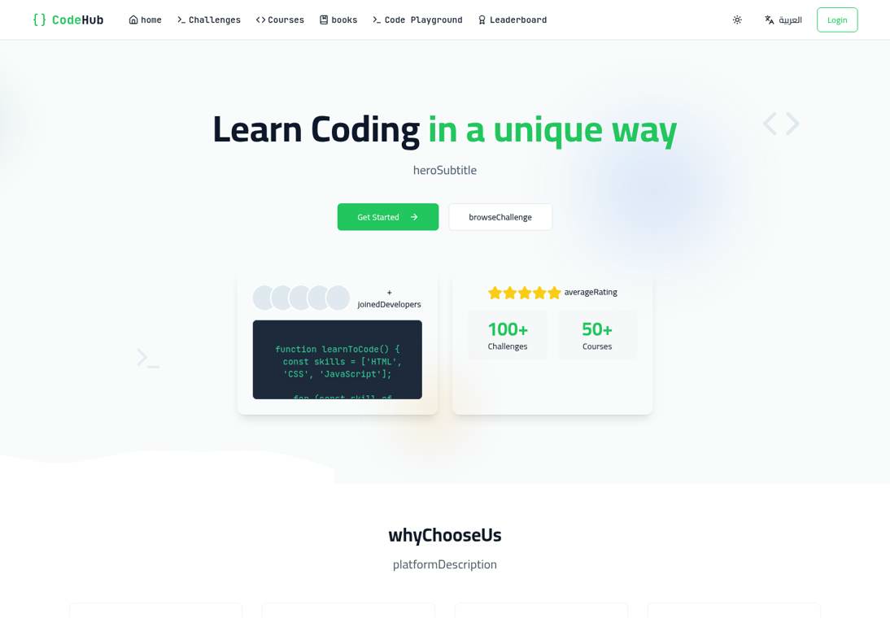

# Code Hub

   [](LICENSE)

An interactive hub for learning to code: practice challenges, a built-in code playground, and a library of programming books, with user accounts and an admin dashboard.

## Features

- Coding challenges with difficulty levels and detail pages
- In-browser code playground
- Programming books library
- Authentication and user profiles (Supabase)
- Admin dashboard for managing challenges and books

## Preview



## Tech stack

- React + TypeScript + Vite
- Tailwind CSS + shadcn/ui
- Supabase (auth and database)

## Run locally

```bash
npm install
npm run dev
```

The Supabase project URL and anon key are already in `src/integrations/supabase/client.ts`, but the backend must still be available and configured for your deployment. For your own copy, use your own Supabase project and policies. Never put a service-role key in browser code.

## Build check

```bash
npm ci --ignore-scripts
npm run build
```

A GitHub Actions build workflow is included. The production build was checked locally with Node.js 22.
